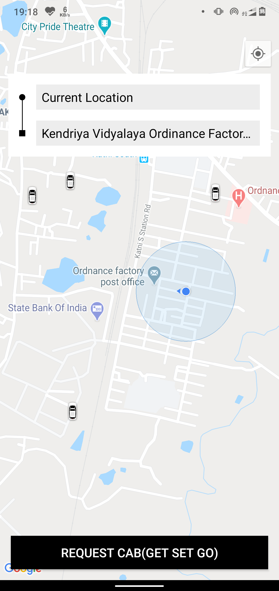
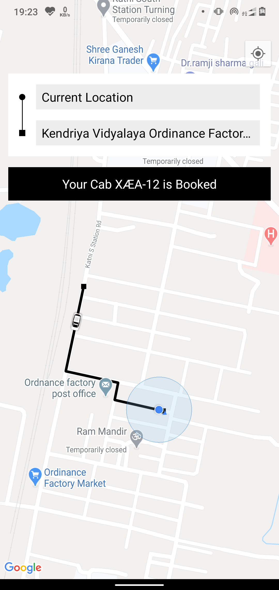
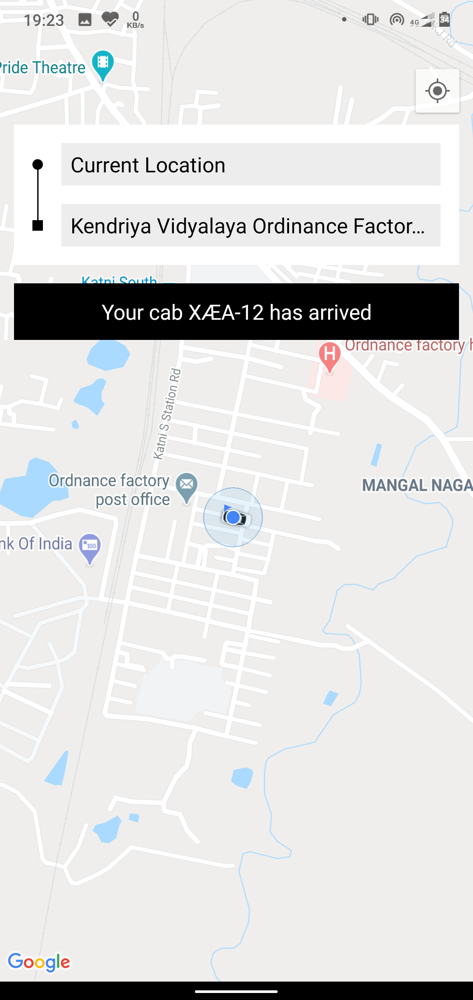
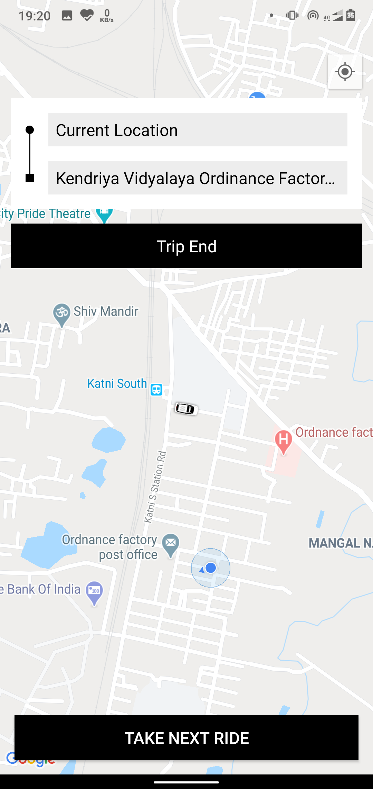

# Ride-Sharing-Project 

## This is Android project based on Cab Service Utilities , MVP Architecture with the help of Google Maps API

## Setup
To run this project, you need a Google Maps API Key. Add your key to `app/src/main/res/values/strings.xml`:
```xml
<string name="google_maps_key">YOUR_API_KEY_HERE</string>
```
Ensure the **Maps SDK for Android**, **Places API**, and **Directions API** are enabled in the Google Cloud Console.

## `Screen Shots`

<table style="padding:10px">
  <tr>
    <td> 
         </td>
      
 <td></td>
   <td></td>
    
   <!--<td></td>-->
  </tr>
</table>
